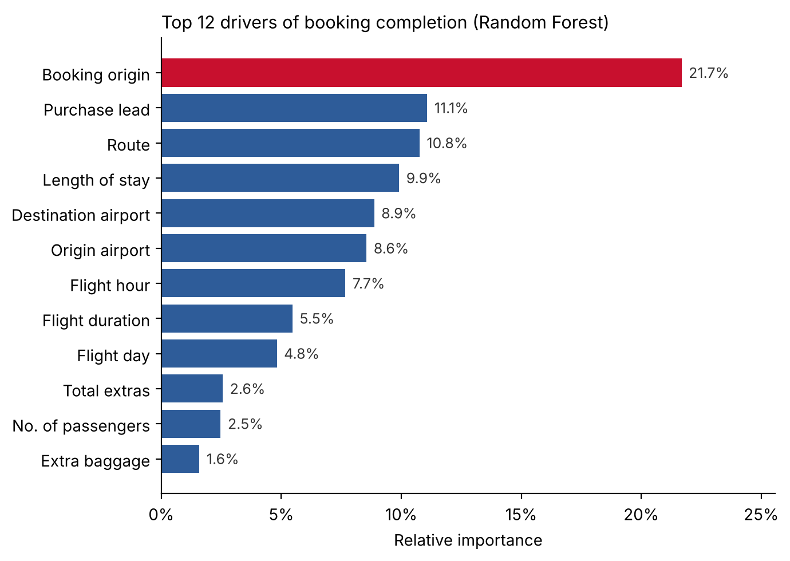

# Project 1: British Airways Data Science Job Simulation (Forage)

Two data science tasks from the British Airways virtual job simulation on Forage:

1. **Lounge eligibility modelling** for Heathrow Terminal 3: a reusable lookup table that estimates what share of passengers is eligible for each lounge tier.
2. **Customer booking prediction**: a Random Forest model that predicts whether a customer completes a booking, with cross-validated evaluation and feature importances.

---

## Repository structure

```
.
├── task1-lounge-eligibility/
│   ├── data/british_airways_summer_schedule.xlsx      # 10,000 flights (input)
│   ├── templates/lounge_eligibility_lookup_template.xlsx
│   ├── src/build_lookup_table.py                      # reproduces the lookup table
│   └── output/
│       ├── lounge_eligibility_lookup_completed.xlsx   # submitted deliverable
│       └── lookup_table_calculated.csv
├── task2-customer-booking-prediction/
│   ├── data/customer_booking.csv                      # 50,000 bookings (input)
│   ├── templates/powerpoint_template_task2.pptx
│   ├── notebooks/customer_booking_model.ipynb         # full analysis, with outputs
│   └── output/
│       ├── customer_prediction_summary.pptx           # submitted deliverable
│       └── feature_importance.png
├── requirements.txt
└── README.md
```

---

## Task 1: Lounge eligibility lookup table

**Goal:** estimate the percentage of passengers eligible for each British Airways lounge tier at Heathrow Terminal 3, in a way that works for future schedules without flight-level detail.

| Tier | Lounge | Eligible customers |
|---|---|---|
| 1 | Concorde Room | First Class, BA Premier, Gold Guest List |
| 2 | First Lounge | BA Gold |
| 3 | Club Lounge | BA Silver, Club World (business) |

**Method**
- Grouped all 10,000 flights by **haul type (short/long) × time of day** (Morning, Lunchtime, Afternoon, Evening): 8 groups.
- Eligibility % = total eligible passengers ÷ total seats in each group (full-flight assumption, as no load factor was given).
- Region was tested as a grouping but long-haul regions (North America, Middle East, Asia) showed almost identical rates, so it was left out.

**Result**

| Grouping | Tier 1 % | Tier 2 % | Tier 3 % |
|---|---|---|---|
| Short-haul – Morning | 0.34 | 4.36 | 16.74 |
| Short-haul – Lunchtime | 0.39 | 4.55 | 17.28 |
| Short-haul – Afternoon | 0.34 | 4.31 | 16.59 |
| Short-haul – Evening | 0.33 | 4.45 | 17.00 |
| Long-haul – Morning | 0.21 | 2.79 | 10.63 |
| Long-haul – Lunchtime | 0.18 | 2.71 | 10.38 |
| Long-haul – Afternoon | 0.20 | 2.77 | 10.52 |
| Long-haul – Evening | 0.21 | 2.67 | 10.26 |

**Key points**
- Haul type is the main driver; time of day adds small but consistent differences useful for peak planning.
- Tier 1 is treated as **hypothetical demand**, since there is no Concorde Room at Terminal 3.
- To apply to a future schedule: look up each flight's group and multiply the percentages by its seats.

---

## Task 2: Predicting customer bookings

**Goal:** predict whether a customer completes a booking (`booking_complete`) and explain which variables drive that prediction.

**Data preparation**
- Removed 719 duplicate rows (49,281 remaining). Only ~15% of customers complete a booking, so the classes are imbalanced.
- New features: `is_weekend`, `total_extras` (baggage + seat + meals), origin and destination airports split from `route`.
- High-cardinality text columns frequency-encoded; `sales_channel` and `trip_type` one-hot encoded.

**Model**
- `RandomForestClassifier` (300 trees, `min_samples_leaf=5`, `class_weight="balanced"`).
- Evaluated with **5-fold stratified cross-validation**.

**Cross-validation results**

| Metric | Mean |
|---|---|
| ROC-AUC | 0.786 |
| Accuracy | 0.764 |
| Recall (bookers) | 0.622 |
| Precision (bookers) | 0.342 |
| F1 (bookers) | 0.441 |

**Feature importance**



**Findings**
- **Booking origin** is the strongest driver (~22% of importance): completion rates range from ~35% (Malaysia) to ~5% (Australia).
- Purchase lead, route, length of stay and flight hour also contribute; ancillary choices, trip type and weekend flights add little.
- The data is moderately predictive: the model finds most bookers but produces many false positives.
- **Next steps:** add behavioural data (browsing sessions, price, past bookings), tune hyperparameters and test gradient boosting to improve precision.

---

## How to run

```bash
pip install -r requirements.txt

# Task 1
cd task1-lounge-eligibility
python src/build_lookup_table.py

# Task 2
cd ../task2-customer-booking-prediction/notebooks
jupyter notebook customer_booking_model.ipynb
```

## Tools

Python (pandas, scikit-learn, matplotlib), Jupyter, Microsoft Excel (pivot tables), PowerPoint.

## Acknowledgement

Datasets and templates were provided by British Airways via the [Forage](https://www.theforage.com) virtual job simulation, for educational use.
